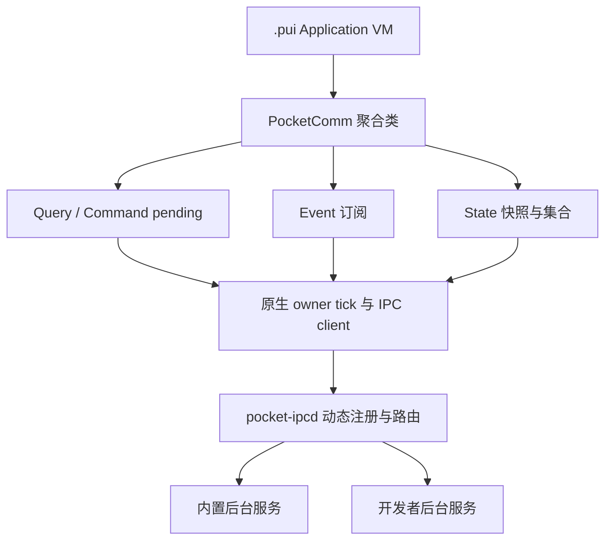

# Service IPC：四类通信与当前 Framework 的开发集成

本实现对应独立交付事项 [#82](https://github.com/hvritual/ui/issues/82)，属于
[P6 / #8](https://github.com/hvritual/ui/issues/8) 的通用通信基础设施与开发接入部分。
后台进程可以动态注册自己的服务和接口，UI 通过 `.pui` 内的 JavaScript 调用；
增加一个业务服务不需要修改 `pocket-ipcd`、传输协议或 `ui-framework`。

当前提供 Linux C provider SDK、Application VM 的原生桥与 JS `PocketComm`。
完整公开 SDK / Go SDK 留在 #40；生产身份、签名和准入策略留在 #9。
这里的测试服务只有内存计数器。实际设备控制服务接入和实机验证仍属于 #8，
不能由计数器、QEMU 或软件像素结果替代。

## 1. 四种语义，共用连接与聚合入口

| 类型 | 语义 | 调用方结果 | 核心约束 |
| --- | --- | --- | --- |
| Query | 一次有截止时间的请求与响应 | `Promise<Result<T>>` | 不改变业务状态；无 Command 幂等键 |
| Command | 一次业务动作请求与响应 | `Promise<Result<Receipt>>` | 调用方必须提供幂等键；成功响应的含义由服务契约定义 |
| Event | 按条件订阅发生的事情 | 订阅句柄和事件回调 | 不保存历史；同一服务 incarnation 内有游标 |
| State | 按条件观察当前集合 | 原子快照、upsert、remove、reset | provider 是权威；恢复必须重新获取快照 |

底层共用 AF_UNIX `SOCK_STREAM` 连接、帧编解码和错误码。Request/Reply、
Event fan-out、State snapshot/watch 分别实现自己的生命周期，没有把四者压成
一个万能 `send(type, payload)` 业务接口。



UI ELF 仅链接 `wire.c` 和 `client.c`，以及通用 Application 原生桥。
broker 单独运行；provider SDK 与业务 handler 位于后台可执行文件中。
`contracts/runtime-ownership.json` 与实际编译命令检查禁止业务测试或 application
原生源码混入固定 UI ELF。

## 2. 在 Application 中使用

将 `sdk/ipc/js/pocket-comm.js` 放在应用源码前面，最后调用
`PocketComm.install(PocketApplication)`。现有 `.pui` 仍只有一个
`application.js` 入口，不引入运行时动态加载器。

```javascript
const comm = new PocketComm({
  onError(error) { model.callbackError = error.code; }
});

async function addOne() {
  const before = await comm.query.call('vendor.counter.v1', 'get', {});
  if (!before.ok) {
    model.error = before.error;
    return;
  }
  const result = await comm.command.execute(
    'vendor.counter.v1', 'add', {delta: 1},
    {timeoutMs: 2000, idempotencyKey: model.operationKey}
  );
  if (result.ok) model.receipt = result.value;
  else model.error = result.error;
}

const events = comm.events.subscribe(
  'vendor.counter.v1', 'changed',
  {eq: {key: 'parity', value: 'odd'}},
  result => {
    if (result.ok) model.lastEvent = result.value.value;
    else model.eventError = result.error;
  }
);

const state = comm.states.watch(
  'vendor.counter.v1', 'counter',
  {eq: {key: 'parity', value: 'odd'}},
  result => {
    if (result.ok) model.items = result.value.items;
    else { model.items = []; model.stateError = result.error; }
  }
);
```

`await` 提供顺序书写、异步完成的效果。它不阻塞 UI 线程；没有嵌套消息循环，
也没有在 UI 线程等待 socket 的同步函数。应用 `start/event/tick/inspect`
生命周期函数仍必须同步返回；可以启动一个内部 async 业务流程并处理它的异常。

`PocketComm.install` 包装同步 tick。F6 输入回调和 start 只提交 JS 意图，
原生提交、收包和订阅回调在安全的 owner tick 中执行。VM 随后排空有限的
Promise jobs。因此业务回调应先更新 JS model，再由下一次 tick 将可见字段
投影到现有组件或 Reactive 接口。不要从异步业务代码重入卸载流程。

### Result 与订阅句柄

普通业务拒绝、离线、超时、取消和资源不足都返回 Result，避免普通错误变成
未处理的 Promise rejection 并触发 Application 失败闩锁：

```javascript
{ok: true, value: result}
{ok: false, error: {code: 'TIMEOUT', effect: 'unknown'}}
```

`effect: 'unknown'` 表示一个已接受的 Command 的业务效果无法由当前通信结果确定。
这时不能根据超时推断“没有执行”，也不能自动换一个幂等键重试。
业务权威需要按原操作键查询或重试，并定义是否能够持久去重。

Query/Command 返回的 Promise 带 `cancel()`。Event/State 句柄包含：

- `ready`：`Promise<Result>`；Event 在订阅确认时完成，State 在完整快照结束后完成。
- `close()`：终止订阅意图，幂等；随后由 tick 发送 unsubscribe。
- `active`：句柄是否仍有效；不等同于已完成服务握手。
- State 的 `current()`：返回已提交快照/增量集合的副本。

Event 回调的成功值为 `{value, cursor, serviceEpoch}`，其中 `value` 是业务 payload。
State 成功值为 `{type, items, revision, serviceEpoch, key?, value?}`。
`type` 是 `snapshot`、`upsert`、`remove` 或 `reset`。
所有 uint64 ID、版本和游标在 JS 中使用十进制字符串，避免精度丢失。

回调抛错不会使整个 VM 因未处理 rejection 停止；可通过 `onError`、`lastError`
和 `callbackErrors` 观察。生产业务仍应明确处理回调错误。

### 第一版筛选范围

仅支持全部订阅（`null`）或一个精确字符串等值条件：

```javascript
{eq: {key: 'status', value: 'failed'}}
```

`in`、比较运算、多字段、AND/OR 或用户可执行表达式不会静默降级，而是返回
`INVALID`。筛选针对 provider 附带的 metadata，不是 broker 解析任意业务 JSON。
改变筛选条件时关闭旧句柄并创建新 watch，得到新快照。

## 3. 独立后台进程如何扩展

provider 包含 `hosts/linux/ipc/service.h`，声明服务名、成员种类和 handler。
注册信息是运行时数据，不是内核中的业务枚举或硬编码路由。

```c
PocketServiceMember members[] = {
    {POCKET_SERVICE_QUERY, "get", query_handler, context},
    {POCKET_SERVICE_COMMAND, "add", command_handler, context},
    {POCKET_SERVICE_EVENT, "changed", NULL, NULL},
    {POCKET_SERVICE_STATE, "counter", NULL, NULL}
};
PocketService service = {0};
PocketServiceConfig config = pocket_service_config();
config.socket_path = socket_path;  /* host-owned configuration */
config.service = "vendor.counter.v1";
config.members = members;
config.member_count = sizeof(members) / sizeof(members[0]);
PocketIpcStatus result = pocket_service_open(&service, &config);
/* The existing owner loop subsequently calls pocket_service_pump(&service, 16). */
```

SDK 复制服务名、成员表和 socket 路径；handler 的 context 仍由进程拥有。
payload 和请求中的借用指针只在 handler 返回前有效。后续工作需要显式复制数据。
业务 JSON 的 schema、鉴权后的业务规则、命令结果、幂等日志均属于 provider。
SDK 和 broker 不理解 `delta`、设备编号或设备控制指令。
Command handler 已产生部分效果但不能确定最终结果时，应调用
`pocket_service_error_uncertain()`；默认或非法 Command reply 也会标记未知效果。
普通 `pocket_service_error()` 适用于已知无效果的前置拒绝或已知完成回滚的情况。

第一版 provider 是单 owner、有限成员、短同步 handler 模型。`pump` 限制处理
消息数量，无法抢占一个阻塞的 C handler。长任务应返回 Accepted receipt，
由服务已有 worker 或业务状态机继续运行，通过 Event/State 公布进展。
SDK 不负责创建常驻进程、线程或启动硬件；进程生命周期交给已有系统启动机制。

`tests/ipc/service_fixture.c` 是可编译的完整独立进程例子。它可在启动时改变
服务名及四种成员名，用于证明固定 ELF 对新业务契约保持无感。
计数器的 16 条幂等记录只在该进程存活期间有效，满后拒绝新操作，不淘汰旧记录。
这个测试策略不是可跨服务崩溃的生产幂等实现。

## 4. State 的一致性与恢复

provider 拥有有限 keyed store。一个非零 uint64 key 在该服务 incarnation 内
表示同一条业务记录；业务字符串 ID 也可保存在 payload 中。

watch 安装、集合筛选、BEGIN/items/END 快照构造与后续变更都在同一 owner
串行发生。快照通过 `send_batch` 整批入发送队列；容量不足时不发送半个快照。
JS 收到 END 前暂存快照，END 后整体替换当前集合。
第一版的 RESET 终止旧 watch 并清空缓存；同一订阅 ID 不会继续接收新快照。

增量同时比较旧 metadata 和新 metadata，覆盖：

| 旧记录匹配 | 新记录匹配 | 订阅者看到 |
| --- | --- | --- |
| 否 | 是 | upsert，成员进入集合 |
| 是 | 是 | upsert，更新当前成员 |
| 是 | 否 | remove，成员离开集合 |
| 否 | 否 | 无消息 |

显式删除一个匹配成员也产生 remove。状态变更无法完成所需发送时，SDK 保留
原 store 和 revision，向权威调用方返回背压错误；调用方需要重试最新投影或
恢复快照，不能忽略错误并假设 UI 已更新。

路由使用 broker epoch、connection epoch、request/subscription ID 与 service
epoch。服务或连接失效后清理 pending 和订阅，旧 epoch 的迟到消息不能写入
新的会话或新的 App 实例。Frame 与 inbox 都有容量上限。

`PocketComm.reconnect()` 影响整个 Application 共享连接，先使旧工作失效，
不重放已接受 Command，也不隐式恢复旧订阅。调用方在恢复后显式创建新的
Event/State 订阅；State 必须重新等完整快照。provider 的 reconnect 保留该
进程自身的权威状态，并清除旧 watch。服务进程重启后的状态恢复由业务负责。

## 5. 包权限与开发信任边界

新增 `.pui` capabilities 为 `ipc.query`、`ipc.command`、`ipc.events` 和
`ipc.state`，分别为 16/32/64/128。旧包默认能力仍为 7，旧 IME 包仍为 15。
`runtime_api=1` / `sdk_api=1` 保持不变；这是显式 opt-in 的开发扩展。
不了解这些能力的旧 Runtime 会拒绝包，而不是赋予隐式权限。

每种调用在原生桥按已应用的包 policy 单独检查。JS 无权选择任意 socket 路径。
host 通过 `PocketApplicationIpcConfig` 或 `pocket_framework_open_package_ipc`
传入可信配置。当前 CLI 只在显式 headless 开发运行中接受
`--ipc-development-socket`，并要求使用已准入的 package。

broker 根据 `SO_PEERCRED` 和显式配置的 client/provider UID 决定开发接入。
自报 app ID 或 wire capability 不是权限来源。同 UID 进程之间没有租户隔离；
这不满足第三方不可信应用的生产权限边界。进一步的注册 ACL、调用者身份和
生产签名准入必须在 #9/#40 的契约中完成。

报告中的 `ipc_command_capable` 表示已经获得 IPC Command 能力；
`business_commands=false` 表示测试没有进行实际设备控制。`ipc_development`
不等于生产准入。未签名 `.pui` 默认仍拒绝，需要显式开发参数。

## 6. 边界和资源预算

机器可读契约见 `contracts/service-ipc.json`，以 C 头文件中的常量为实现依据。
当前帧头 82 字节，整个最大帧 1169 字节，payload 最多 768 字节。
payload 使用 UTF-8；零字节、非法编码、越界长度和未知协议版本被拒绝。
没有 native 指针、JSValue 或 UI handle 跨进程传输。

- 一条 channel 最多 32 个待发送帧；client 最多 32 pending、16 订阅、64 inbox 消息。
- broker 最多 8 peers、64 注册成员、64 routes、64 订阅。
- 一个 provider 最多 16 成员、16 状态项、16 watches。
- Application 最多 4 个 `PocketComm` 实例，共享原生连接与整体配额；每个 watch 最多缓存 32 项。
- 一个 tick 的 SDK 发送预算为 16 次；原生 `ipc.take` 的 JSON 包装保持在现有 8192 字节限制内。

这些是第一版明确的有限规模，不是无限动态服务承诺。更多业务协议可以动态
注册，但超过固定资源容量必须得到可观察的 BUSY/TOO_LARGE 等错误。
未来扩容应修改通用资源配置或新版本协议，不把某个业务服务加入传输内核。

## 7. 构建、运行与证据

在仓库锁定的工具链、干净已提交源码上运行：

```sh
make test-ipc test-ipc-arm test-ipc-sanitize verify-ipc
# 先按现有流程准备真实 Runtime、Framework assets 与 production UI ELF：
make test-framework test-framework-arm
make test-ipc-framework test-ipc-framework-arm verify-ipc-framework
```

前一组包含真实 AF_UNIX 的 codec、pending、broker 和 provider 测试；Node
测试只验证 JS facade 语义。后一组启动独立 broker、provider、production UI
进程，通过真实 `.pui` → QuickJS → 原生桥 → socket → provider → 回包 →
JS model → renderer 路径验收，不能由 Node mock 或 C socket 单测替代。

`scripts/ipc_acceptance.py` 在两个分辨率验证四类流量、同键去重和冲突、Event
过滤、State 进入与移除；再向仍运行的 broker 注册不同服务和成员名，使用第二
个 `.pui` 驱动同一个 UI ELF。还逐一删除四类包权限，并验证错误以 Result 返回，
以及 broker 缺席时的 VM 存活和清理。

证据位于 `out/ipc/` 和 `out/framework/`，绑定源码 commit/tree、源码哈希、
实际二进制哈希、编译输入归属、进程运行日志、包哈希、报告与前后帧。
Native/ARM 像素和业务断言结果交叉比较。QEMU 只提供软件功能证据。
默认 IPC ARM 可执行文件使用锁定的 GNU 动态 ABI，作为 QEMU 软件测试产物。
另有独立的[静态 IPC 上板诊断包](ipc-board.md)：同一提交的静态 UI、broker
和合成 provider 在板上以 headless 模式运行，不依赖板端 GNU 动态 loader。
它保留现有开发入口约束，与 LCD／触摸板包分开；实际 BSP 兼容、物理性能、
生产服务身份和设备业务仍需要独立验证。

`--development` 和已有 `FRAMEWORK_DEVELOPMENT=1` 只用于本地诊断，产物明确
标记 development，不能通过 canonical verify。工具缺失、AF_UNIX 被环境禁用、
脏工作区、源码或二进制变化、缺少任何一个验收结果都会阻止相应门禁通过。

手工运行可参考测试脚本中独立进程的参数：

```sh
out/ipc/native/pocket-ipcd --socket /tmp/pocket-demo/broker.sock --client-uid 1000 --service-uid 1000
out/ipc/native/service-fixture --socket /tmp/pocket-demo/broker.sock --service demo.counter.v1
out/framework/native/ui-framework --headless --profile imx6ul-1024x600 \
  --package path/to/ipc-example.pui --allow-unsigned-package \
  --ipc-development-socket /tmp/pocket-demo/broker.sock --seconds 3 --output new-output-directory
```

目录和 UID 应由运行者按实际环境创建/配置；broker 不删除任意已有路径。
`service-fixture` 是测试程序，不能作为设备服务部署。
